# Live metrics verification

Verified on 13 October 2026. Type checks, 44 backend tests, 20 chart/setup tests,
real-agent enrollment/refresh/offline checks, and the scaled integration suite passed.

The web flow was exercised with one backend and with three backends sharing
TimescaleDB, PgBouncer and Redis, behind the actual Caddy configuration.

```mermaid
flowchart LR
  Agent[Go agent: enrollment, access token, WAL] -->|TLS gRPC| Proxy[Caddy: dynamic replica discovery]
  Proxy --> Ingest[Authenticated ingestion on any replica]
  Ingest --> Commit[Postgres transaction: batch receipt and metrics]
  Commit --> Realtime[Committed telemetry and throttled dashboard card]
  Realtime --> Redis[Redis Pub/Sub adapter]
  Redis --> Socket[WebSocket room on any replica]
  Socket --> Series[Source-time buckets for selected range]
  Series --> Chart[Bounded charts with outage gaps]
  Commit -->|REST history on load or recovery| Series
```



The [recorded results](live-metrics-results.json) include observed per-range point
counts. The browser also recovered its device stream after a local backend
restart without a page reload; its sparse year view rendered five data markers
and all 11 ranges produced zero invalid SVG paths.

## Corrections

- Batch receipts are stored in `ingest_batches` in the same transaction as all
  metric chunks. A unique `(deviceId, batchId)` key coordinates replicas. A
  concurrent duplicate cannot be acknowledged before the original commits;
  failure rolls back both the receipt and every metric chunk. Redis expiry or a
  backend crash cannot turn an uncommitted batch into a successful duplicate.
- Telemetry is broadcast after commit, so persistence failures and retries do
  not add speculative or duplicate chart points. Device identity comes from the
  authenticated access token. The agent continues using its existing WAL and
  access-token refresh/retry behavior. The real agent also passed with temporary
  three-second access tokens across six live dashboard updates.
- Dashboard recomputation is throttled across replicas using Redis. Local
  trailing timers are removed after use and on shutdown. Queue capacity limits
  both batches and queued metric points.
- Online transitions lock/update the device atomically and keep `lastSeenAt`
  monotonic. Offline sweeps apply their cutoff in the update itself, avoiding a
  reconnect-versus-sweep race. Redis lock release compares the owner atomically.
- The web client rejoins device rooms and reloads persisted range history after
  reconnect. Redis subscriber recovery also signals clients to reload missed
  data. Room subscriptions are removed when leaving/changing the device view.
- Live charts use the original metric timestamp (including serialized int64
  values), not browser arrival time. Replayed old batches do not look like new
  activity. REST buckets carry counts and sample boundaries so subsequent live
  samples keep weighted averages; temperature buckets retain the maximum.
- Live buffers aggregate by range instead of accumulating 3,000 raw samples or
  discarding old all-time history. Gap markers remain chronological. Network
  directions with no data are null, not invented zeroes.
- All-time axes have a nonzero domain for one point and bounded, adaptive ticks.
  Short all-time spans use time labels; multi-year spans include the year. A single observed bucket is shown with
  a marker instead of a blank chart. Isolated samples separated by outage gaps also keep markers. Fixed-range axes advance while offline.
- Caddy uses passive failure detection and a bounded retry window. Application
  Redis commands have bounded latency; adapter connections and the shared Redis
  client are closed on shutdown.

## Point budgets

These budgets apply per metric, for both REST history and prolonged live
sessions. Epoch-aligned windows can contain one extra boundary bucket.

| Range | Target numeric buckets | Maximum numeric buckets |
|---|---:|---:|
| 1 minute | 12 | 13 |
| 5 minutes | 20 | 21 |
| 1 hour | 60 | 61 |
| 2 hours | 60 | 61 |
| 5 hours | 60 | 61 |
| 12 hours | 72 | 73 |
| 1 day | 96 | 97 |
| 1 week | 84 | 85 |
| 1 month | 120 | 121 |
| 1 year | 120 | 121 |
| All time | 120 | 121 |

Null outage markers can add at most one point between adjacent numeric buckets.
Short online ranges can add at most two edge points. Thus even a heavily gapped
series stays below 245 rendered points (network merges can include separate gap
markers from either direction). The all-time bucket size continues growing for
multi-decade datasets, rather than stopping at a fixed 30-day bucket size.

## Repeatable checks

Run the focused chart tests on Node 22.6+ (the configured Node version is newer):

```sh
node --experimental-strip-types --test scripts/live-series.test.mjs
npm run typecheck
npm run test --workspace @project-orion/backend -- --runInBand
```

`npm run test:flow` runs the real Go agent against the local development stack;
see the root README for test-account credentials and endpoint overrides.

The scale check requires an isolated, disposable three-replica stack. It creates
its own test account/devices and synthetic histories, and injects a temporary
metrics-insert trigger to test rollback. Do not run it against production.

Create a temporary override with localhost-only dynamic replica ports:

```yaml
services:
  backend:
    ports:
      - "127.0.0.1::4000"
      - "127.0.0.1::50052"
```

Then start the stack and run the verification (use the actual override path):

```sh
SCALE_HTTP_PORT=18080 SCALE_HTTPS_PORT=18443 docker compose \
  -f docker-compose.scale.yml -f /tmp/orion-scale-ports.yml \
  up --build -d --scale backend=3

docker cp project-orion-scale-caddy-1:/data/caddy/pki/authorities/local/root.crt \
  /tmp/orion-scale-ca.crt

SCALE_CA_FILE=/tmp/orion-scale-ca.crt \
NODE_EXTRA_CA_CERTS=/tmp/orion-scale-ca.crt SCALE_FAULTS=true \
node --experimental-strip-types scripts/verify-scale.mjs
```

The test uses the Caddy CA for TLS verification; it does not install a system
trust exception. Temporary per-replica ports can change on Docker restart, so a
local TCP relay keeps the subscriber endpoint stable during the restart test.
Public-client tests use Caddy's stable TLS endpoint directly.

Checks include authenticated cross-replica room delivery, concurrent duplicates,
atomic rollback of a failed second insert chunk, same-ID retry on another
replica, TLS gRPC/WebSocket routing, a 100-batch concurrent burst, reconnect,
replica loss, Redis subscriber recovery, and all 11 range responses. Results are
written to `/private/tmp/orion-scale-results.json`.

## Scope and operational limits

- This is a functional three-replica verification with a bounded burst, not a
  production throughput/latency capacity benchmark. Postgres, Redis and Caddy
  remain shared dependencies; increasing backend replicas alone does not scale
  their capacity. The initial dashboard snapshot is currently capped at 200
  devices; larger fleets need pagination and a separate sustained-load benchmark.
- Redis Pub/Sub does not replay missed events. REST recovery uses the persisted
  metrics as the source of truth. This follows the [Socket.IO Redis adapter
  contract](https://socket.io/docs/v4/redis-adapter/).
- The existing Timescale migration retains **30 days** of metrics. Year and
  all-time views can display only retained data. The synthetic multi-year
  fixture verifies chart/query behavior before the retention job removes it.
- Batch receipts intentionally outlive metric retention so old WAL retries do
  not recreate purged metrics. They need an explicit archival/cleanup policy
  tied to the maximum supported WAL replay age before production-scale use.
- `DB_SYNCHRONIZE=true` creates the receipt table in disposable local dev.
  Production/scaled deployments must run the new receipt migration before
  starting updated replicas.
- The native iOS client was inspected but was not exercised in the simulator;
  this verification covers the web charts and their shared backend/agent flow.
